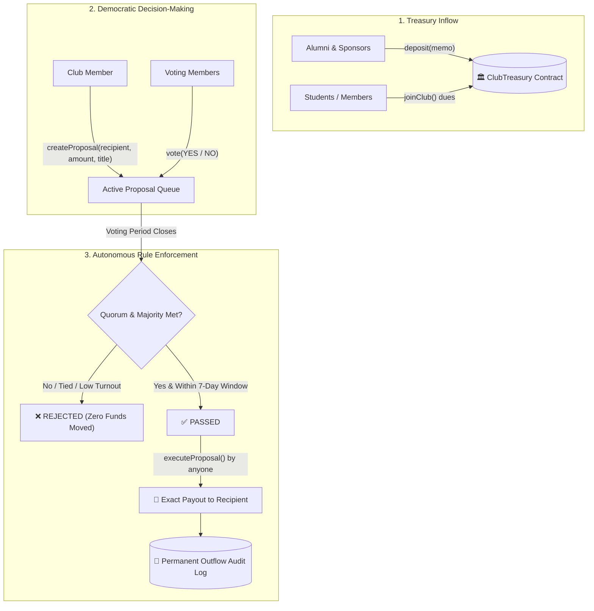

# 🏛️ Trustworthy Club Treasury (VibeChain @ MERAZ 7.0)

> **Decentralized, Transparent & Abuse-Resistant Club Treasury dApp**  
> *Built for VIBECHAIN – The Ultimate Blockchain Challenge (DSC × BIB) at MERAZ 7.0, IIT Bhilai.*

[](https://soliditylang.org/)
[](https://hardhat.org/)
[](https://react.dev/)
[](https://tailwindcss.com/)
[](https://opensource.org/licenses/MIT)

---

## 📌 1. Project Overview & Problem Statement

### The Real-World Problem
In universities and student communities, clubs pool money for events, workshops, cultural fests, equipment, and travel. Today, this money typically lives in a personal bank account or a UPI handle controlled by one or two students.
- **Private Decision-Making:** Spending choices occur in private WhatsApp chats without community consensus.
- **Lost Accountability & Receipts:** Months later, paper bills and digital receipts disappear, leaving members unable to verify who approved what.
- **Trust-Based Fragility:** No student or alumni can verify with certainty whether money went to legitimate vendors, or whether funds remain in the treasury.

### The Solution: Trustworthy Club Treasury
**ClubTreasury** replaces human discretion with immutable smart contract rules:
1. **Public Inflows:** Anyone (students, alumni, sponsors) can deposit funds on-chain with a permanent memo.
2. **Democratic Membership:** Members hold equal voting weight (1 member = 1 vote). Whales cannot purchase disproportionate governance.
3. **Transparent Outflows:** Not a single wei can leave the treasury without a formal on-chain proposal, public voting period, quorum approval, and majority vote.
4. **Permanent Audit Trail:** Every outflow is immutably indexed with recipient, purpose, timestamp, and proposal reference.
5. **Zero Backdoors:** Neither the deployer, president, nor admin possesses a backdoor sweep function. The contract is 100% autonomous.

---

## 🏛️ 2. System Architecture



---

## ⚖️ 3. Justification of Design Choices (Mandatory Deliverable)

Our architecture specifically addresses the core questions posed by the problem statement judges:

### 1. Who is allowed to do what?
* **Anyone (Public / Alumni / Sponsors):** Can deposit funds, view real-time holdings, inspect proposals, and audit all historical outflows.
* **Club Members:** Can create spending proposals, initiate membership votes, and cast votes (`YES` / `NO`).
* **Deployer:** Has **zero special spending privileges**. The deployer is simply bootstrapped as the initial member so initial governance can begin.

### 2. How does a decision about money get made?
* Decisions require a formal on-chain proposal specifying `recipient`, `amount`, `title`, `description`, and `votingDuration`.
* A proposal passes only if:
  1. The voting duration has elapsed (`block.timestamp >= votingDeadline`).
  2. The proposal is executed within the active window (`block.timestamp <= votingDeadline + 7 days`).
  3. Strict majority is achieved (`yesVotes > noVotes`; ties are strictly rejected).
  4. **Dynamic Quorum is satisfied** ($\ge 20\%$ participation, min 2 votes for multi-member clubs).

### 3. Why can NO single person quietly misuse the funds?
* **Zero Backdoor Functions:** The contract contains no `withdrawAll()`, `ownerWithdraw()`, or emergency sweep functions.
* **Anti-Hijack Quorum:** Prevents a single rogue member from creating a short-deadline proposal and passing it with their own vote.
* **Checks-Effects-Interactions (CEI):** Reentrancy attacks are impossible because `executed = true` is committed to storage before any external ETH transfer.

### 4. What can a member verify publicly afterwards?
* All historical inflows (`getInflowRecords()`) and outflows (`getOutflowRecords()`) are stored in public contract state.
* Every outflow record includes: `proposalId`, `recipient`, `amount`, `purpose`, and `timestamp`.

---

## 🛡️ 4. Mandatory Safety Invariants (Proofs Matrix)

| # | Safety Invariant | Implementation Mechanism in `ClubTreasury.sol` |
|---|---|---|
| **1** | **Contract can never pay out more than it holds** | Mathematical balance verification: `require(address(this).balance >= prop.amount)` at both proposal creation AND execution. |
| **2** | **No authorization can move funds more than granted for** | Replay & Double-Spend Prevention: `require(!prop.executed); prop.executed = true;` executed strictly before external transfers. |
| **3** | **An action rejected, expired, or never authorized must not move funds** | 1) Rejections blocked if `yesVotes <= noVotes` or quorum fails. 2) Expired proposals blocked after `EXECUTION_WINDOW = 7 days`. 3) Active voting proposals cannot be executed prematurely. |
| **4** | **No backdoors for deployer or admins** | Verified: **Zero** admin withdrawal or sweep functions exist in code. |
| **5** | **Reentrancy Protection** | Built-in non-reentrant mutex guard (`nonReentrant`) + strict adherence to the **Checks-Effects-Interactions** pattern. |

---

## 💻 5. Technology Stack

- **Smart Contracts:** Solidity `^0.8.20`, compiled with optimization (200 runs).
- **Framework & Testing:** Hardhat 2.22, Mocha, Chai, `@nomicfoundation/hardhat-toolbox`.
- **Frontend dApp:** React 18, Vite 6, Tailwind CSS, Lucide Icons, Ethers.js v6.
- **Target Network:** Ethereum Testnet (Sepolia) / EVM-compatible chains.
- **Live Hosting:** Vercel Global Edge Network.

---

## 🚀 6. Quickstart & Setup Guide

### 1. Clone & Install Dependencies
```bash
git clone https://github.com/KRISHAL-SUKDEVE/trustworthy-club-treasury.git
cd trustworthy-club-treasury

# Install root dependencies
npm install

# Install frontend dependencies
cd frontend
npm install
cd ..
```

### 2. Compile & Run Tests
To verify all **36 security and invariant unit tests**:
```bash
# Compile contracts using solc 0.8.20
node scripts/compile.js

# Run full test suite (36 passing tests)
npm test
```

### 3. Run Frontend Development Server
```bash
cd frontend
npm run dev
```
Open [http://localhost:3000](http://localhost:3000) in your browser.

---

## 🌐 7. Deployment Details & Live Demo

### Live Demo & Repository
- **GitHub Repository:** [https://github.com/KRISHAL-SUKDEVE/trustworthy-club-treasury](https://github.com/KRISHAL-SUKDEVE/trustworthy-club-treasury)
- **Live Demo dApp:** [https://trustworthy-club-treasury.vercel.app/](https://trustworthy-club-treasury.vercel.app/)
- **Target Network:** Ethereum Sepolia Testnet
- **Contract Address:** `0x5FbDB2315678afecb367f032d93F642f64180aa3` *(Dynamically configurable in UI top settings bar)*

### Deploying to Sepolia Testnet
1. Create a `.env` file in the root directory:
   ```env
   SEPOLIA_RPC_URL=https://rpc.sepolia.org
   PRIVATE_KEY=your_private_key_here
   ```
2. Deploy the contract:
   ```bash
   npm run deploy:sepolia
   ```

---

## 🔍 8. Round 2: Security Audit Checklist & Bug Hunting Guide

For Phase 2 ("Break the Bugs"), we provide [`AUDIT_CHECKLIST.md`](./AUDIT_CHECKLIST.md) covering:
1. *Owner Backdoors:* Searching for `onlyOwner` sweeps or privileged drains.
2. *Reentrancy:* Checking for state changes occurring after external `.call{value: ...}`.
3. *Single-Voter Drains:* Verifying whether missing quorums allow 1-vote proposal passing.
4. *Replay Loopholes:* Checking for missing or re-set `executed` booleans.
5. *Deficit Spending:* Testing whether proposals can exceed current contract balance.

---

## 👥 9. Event Details

- **Event:** VIBECHAIN – The Ultimate Blockchain Challenge (DSC × BIB)
- **Festival:** MERAZ 7.0, IIT Bhilai
- **Date:** 1 November 2026

*Licensed under the [MIT License](LICENSE).*
