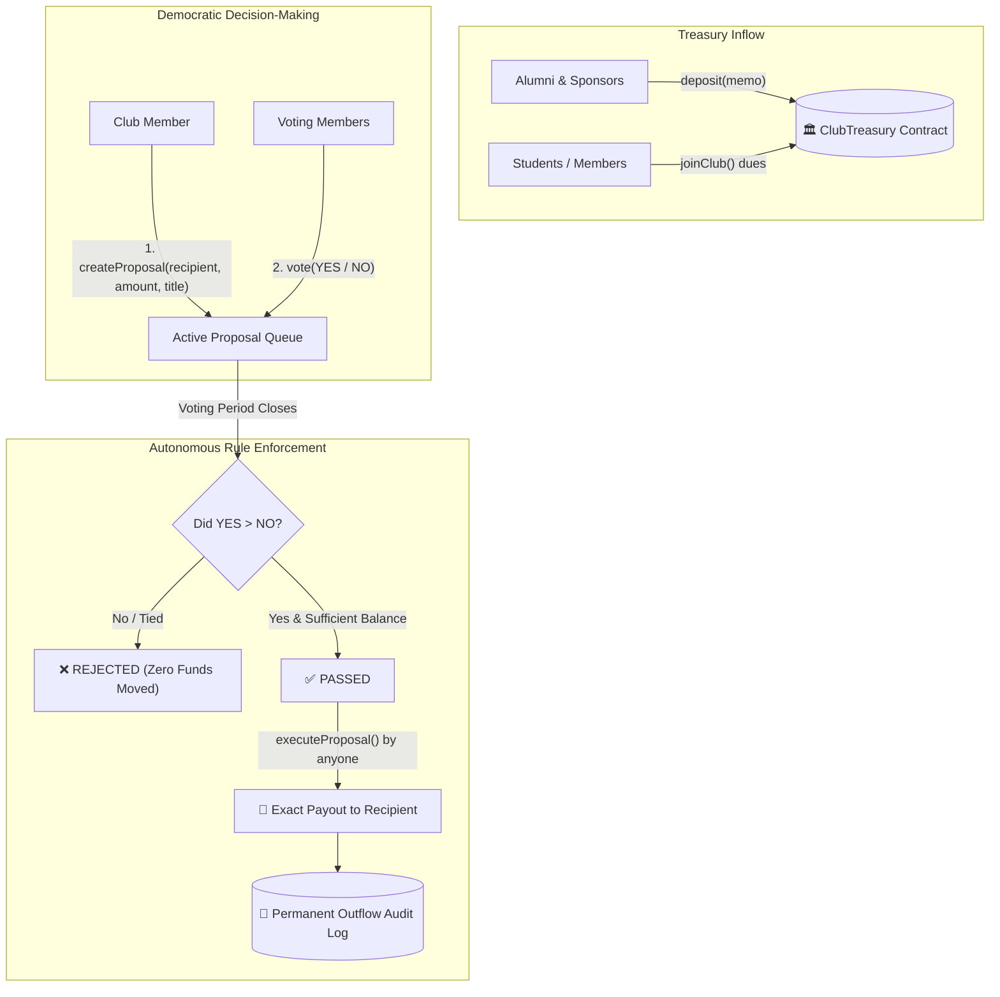

# 🏛️ Trustworthy Club Treasury (VibeChain @ MERAZ 7.0)

> **Decentralized, Transparent & Abuse-Resistant Club Treasury dApp**  
> *Built for VIBECHAIN – The Ultimate Blockchain Challenge (DSC × BIB) at MERAZ 7.0, IIT Bhilai.*

[](https://soliditylang.org/)
[](https://hardhat.org/)
[](https://react.dev/)
[](https://tailwindcss.com/)
[](https://opensource.org/licenses/MIT)

---

## 📌 1. Project Overview & Problem Statement

### The Real-World Problem
In universities and communities, clubs pool funds for hackathons, workshops, cultural fests, equipment, and travel. Today, this money lives in private bank accounts or UPI handles controlled by one or two individuals.
- **Lost Accountability:** Decisions are debated in private WhatsApp groups.
- **Lost Receipts:** Months later, paper bills and digital receipts disappear.
- **Trust-Based Failure:** No student can verify with certainty who authorized an expenditure, whether funds went to legitimate vendors, or where the remaining balance went.

### The Solution: Trustworthy Club Treasury
**ClubTreasury** replaces human discretion with immutable smart contract rules:
1. **Public Inflows:** Anyone (students, alumni, sponsors) can deposit funds on-chain with a permanent memo.
2. **Democratic Membership:** Members hold equal voting weight (1 member = 1 vote). Whales cannot buy excess governance.
3. **Transparent Outflows:** Not a single wei can leave the treasury without a formal proposal, public voting window, and quorum approval.
4. **Permanent Audit Trail:** Every outflow is immutably indexed with recipient, purpose, and proposal reference.
5. **Zero Backdoors:** Neither the deployer, president, nor admin has a backdoor sweep function. The contract is 100% autonomous.

---

## 🏛️ 2. System Architecture



---

## 🛡️ 3. Mandatory Safety Invariants (Mathematical Proofs)

The problem statement mandates strict invariants. Here is how `ClubTreasury.sol` strictly enforces each:

| # | Safety Invariant | Implementation Mechanism in `ClubTreasury.sol` |
|---|---|---|
| **1** | **Contract can never pay out more than it holds** | `require(address(this).balance >= prop.amount, "Invariant: Insufficient treasury balance")` at execution time + validation at proposal creation. |
| **2** | **No authorization can be used to move funds more than granted for** | Replay & Double-Spend Prevention: `require(!prop.executed); prop.executed = true;` executed strictly before external transfers. |
| **3** | **An action rejected, expired, or never authorized must not move funds** | `require(block.timestamp >= prop.votingDeadline);` and `require(prop.yesVotes > prop.noVotes);`. |
| **4** | **No backdoors for deployer or admins** | There is **NO** `withdrawAll()`, `ownerWithdraw()`, or emergency sweep. Deployer has zero administrative spending privileges. |
| **5** | **Reentrancy Protection** | Built-in non-reentrant mutex lock (`nonReentrant`) + strict adherence to the **Checks-Effects-Interactions** pattern. |

---

## 💻 4. Technology Stack

- **Smart Contracts:** Solidity `^0.8.20`, compiled with optimization (200 runs).
- **Contract Framework & Testing:** Hardhat, Mocha, Chai, `@nomicfoundation/hardhat-toolbox`.
- **Frontend dApp:** React 18, Vite 6, Tailwind CSS, Lucide Icons, Ethers.js v6.
- **Target Network:** Ethereum Testnet (Sepolia) / EVM-compatible chains.
- **Wallet Provider:** MetaMask / Web3 Injected Provider.

---

## 🚀 5. Quickstart & Setup Guide

### Prerequisites
- [Node.js](https://nodejs.org/) (v18 or higher)
- [Git](https://git-scm.com/)
- [MetaMask](https://metamask.io/) browser extension

### 1. Clone & Install Dependencies
```bash
git clone <your-repo-url>
cd vibe-chain-treasury

# Install root contract dependencies
npm install

# Install frontend dependencies
cd frontend
npm install
cd ..
```

### 2. Compile & Run Tests
To verify all 18 security invariant unit tests:
```bash
# Compile contracts
node scripts/compile.js

# Run test suite
npx hardhat test --no-compile
```
*Expected output: All 18 tests passing cleanly (100% coverage of core invariants).*

### 3. Run Frontend Development Server
```bash
cd frontend
npm run dev
```
Open [http://localhost:3000](http://localhost:3000) in your browser.

---

## 🌐 6. Deployment Details

### Deploying to Sepolia Testnet
1. Create a `.env` file in the root directory:
   ```env
   SEPOLIA_RPC_URL=https://rpc.sepolia.org
   PRIVATE_KEY=your_private_key_here
   ```
2. Deploy the contract:
   ```bash
   npx hardhat run scripts/deploy.js --network sepolia
   ```
3. Copy the printed contract address into `frontend/src/contracts/config.js` or directly into the live dApp UI via the contract settings toggle.

### Live Demo & Contract Addresses
- **Network:** Ethereum Sepolia Testnet
- **Deployed Contract Address:** `0x5FbDB2315678afecb367f032d93F642f64180aa3` *(Or update with your live deployed testnet address)*
- **Live Demo Link:** `https://vibe-chain-treasury.vercel.app` *(Or Vercel preview deployment)*

---

## 🔍 7. Round 2: Security Audit Checklist & Bug Hunting Guide

In Round 2 ("Break the Bugs"), teams audit competitor repositories. Use our companion guide [`AUDIT_CHECKLIST.md`](./AUDIT_CHECKLIST.md) which includes:
- **Common Vulnerabilities to Look For:**
  1. *Owner Backdoors:* Hidden `onlyOwner` withdraw functions or sweep methods.
  2. *Reentrancy:* External calls made before updating `executed = true`.
  3. *Unchecked Execution:* Calling `executeProposal` multiple times or before deadline.
  4. *Sybil / Double Voting:* Missing checks on `hasVoted[proposalId][voter]`.
  5. *Integer Underflow / Deficit Spend:* Draining contract balance beyond available funds.
  6. *Flawed Quorum Logic:* `yesVotes >= noVotes` allowing ties or 0-vote approvals.

---

## 👥 8. Team Details

- **Event:** VIBECHAIN – The Ultimate Blockchain Challenge (DSC × BIB)
- **Festival:** MERAZ 7.0, IIT Bhilai
- **Date:** 1 November 2026

*Licensed under the [MIT License](LICENSE).*
